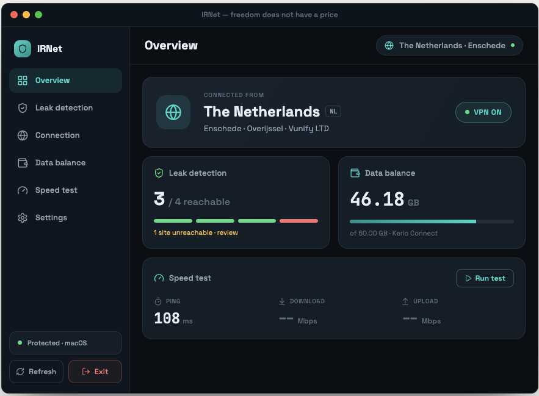

# ir_net

Utility for power users that want to see VPN connection details



## Features
- Show location of connection in map
- Leak detection on your urls
- SysTray icon without the app being open
- Show the flag of the current IP country on the SysTray icon (optional, Windows & Linux)
- Start by startup
- Ability to minimize and hide from taskbar
- Show details of your ISP
- Update status when there is a network change
- Connect through proxy vpn types (eg. ShadowSocks, VMess, ...)
- Auto Connect to Kerio Network
- Show usage and statistics of Kerio network
- Network quality monitor: live ping, jitter, packet loss, real delay (HTTPS) and uptime with a 0–100 score, kept per exit IP so you can compare VPN servers and locations over time
- Online call quality: voice and video call MOS estimated from the probes, plus an on-demand call test (400 voice packets and a bandwidth check)
- Export network quality to share with a network admin: a PDF report (key findings, charts, server comparison), the raw data as CSV files in a ZIP, or a text summary. Desktops save to Downloads; Android and iOS open the share sheet
- Internet usage per app, domain and country of destination with time ranges (10 min to all time) on macOS and Linux; per app on Windows (needs an admin prompt) and Android (needs Usage access)
- V2Ray VPN (Xray core) on Windows, macOS, Linux and Android: VLESS (incl. REALITY, XHTTP), VMess, Trojan and WireGuard (`wireguard://` links or `.conf` files) configs and subscriptions (remaining data and time per subscription), import from the clipboard, a QR code (camera on phones, image file anywhere) or other clients' links, real-delay ping and "test all", Tunnel mode (everything through the VPN; admin prompt on desktop) and Proxy mode (system proxy), LAN bypass, pass-through rules with imported geoip/geosite `.dat` files, and a kill switch that turns Wi-Fi and Ethernet off while the VPN is down. iOS imports and lists configs but can't connect yet

## V2Ray VPN: the Xray core
Desktop builds bundle the official Xray core (pinned version, SHA-256 checked). Fetch it before building; the build scripts below do this for you:
```bash
dart run tool/fetch_xray.dart          # this machine's platform (macos, windows, linux or all)
```
It lands in `third_party/xray/` (git-ignored); the macOS Xcode build phase, `windows/CMakeLists.txt` and `linux/CMakeLists.txt` copy it next to the app. Without it the app builds, but the VPN can't connect. Android pulls the core (AndroidLibXrayLite) through Gradle.

The macOS app is not sandboxed: the VPN has to run the core and change the system proxy. Settings and history from earlier, sandboxed versions are copied over on first launch (macOS may ask to allow access to the old data).

## Build windows installer
Run the build script which updates the version, builds the app, and compiles the installer:
```powershell
.\build_windows.ps1
```
Output .exe file will be in the `inno/Output` directory.

## Build macos package
1. Fetch the Xray core (see above) and build .app file
```bat
dart run tool/fetch_xray.dart macos
flutter build macos --release
```
3. Put it in a folder named IRNet
2. Create a symbolic link to Applications
```bat
ln -s /Applications Applications
```
3. Open Disk Utils app and go to File -> New Image -> Image from folder
4. Select IRNet folder and press save

## Build linux package
1. Build binaries
```bash
./build_linux.sh
```

Output .deb file will be in the `/outputs` directory

Follow the instructions [here](/linux_build.md) for more details (if needed)

## TODO
- Add alternative api service
- Choose default country and show flag based on that
- Option to show all countries flag
- Add statistics eg. (number of times and minutes there was a network error, reasons of network failure)
- Add app launcher icon
- Show error reason in leak detection list
- Show which app occupied a port
- Speed test
- Shortcuts to important screens of windows (eg. Network adapters)
- Retry one more time if there was a leak found during switch to new network
- Reset ip lookup result when there is no network
